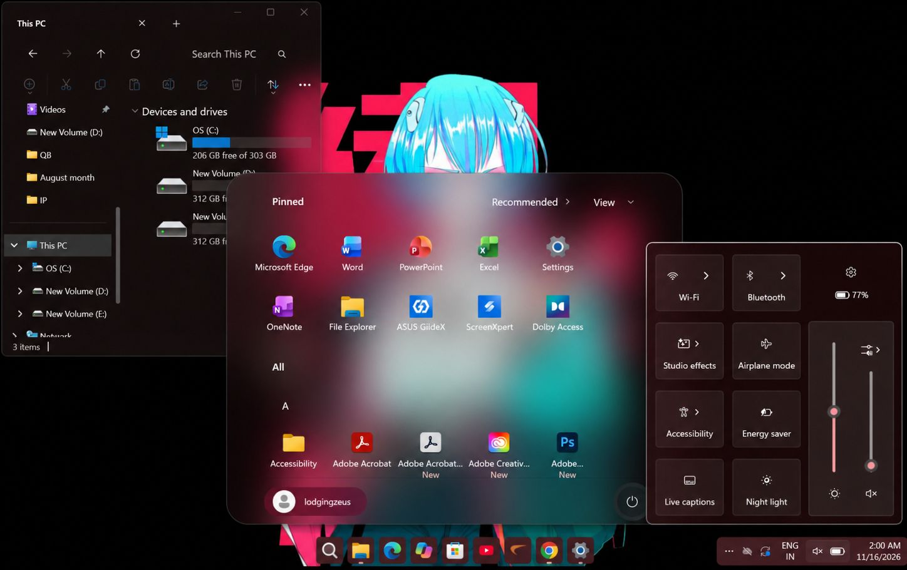
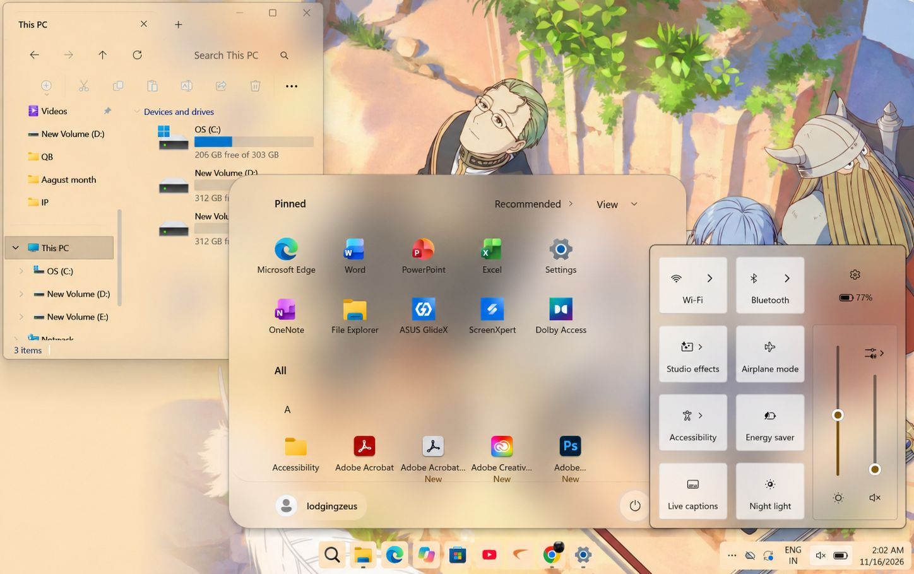
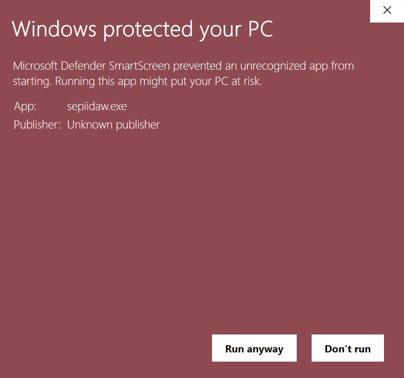

# sepiida

An adaptive theme for the Windows 11 shell. sepiida takes the colours of
your desktop wallpaper and dresses Windows in them: the accent colour,
light or dark mode, and a glass look for the taskbar, Start, quick
settings and File Explorer. Your other apps are left alone.

<p align="center">
  
  
</p>

- Follows the normal Windows wallpaper (picture, slideshow, Spotlight) or
  [Wallpaper Engine](https://www.wallpaperengine.io/) if you use it.
- Re-themes on its own whenever the wallpaper changes.
- Glass or solid surfaces, light or dark, your choice in the settings.
- Everything can be undone.

> **Early development.** The shell styling works by loading a small DLL
> into Windows' shell processes. It is tested on Windows 11 25H2, but a bug
> there can still restart Explorer. Restarting Explorer always brings back
> the stock look.

## First run

sepiida is not code-signed yet (a signing certificate costs money, and the
project is new). Windows treats any unsigned app from a publisher it has not
seen before with caution, so the first time you start `sepiidaw.exe` you may
see this:

<p align="center">
  
</p>

This is SmartScreen saying it does not recognise the publisher, not that it
found anything in the app. Click **Run anyway** (on some Windows versions,
**More info** first). Windows remembers the choice for that file.

If **Smart App Control** is on (Windows Security > App & browser control),
it blocks unsigned apps outright and offers no "Run anyway". sepiida can only
run with it turned off. On some Windows versions it cannot be turned back on
without resetting Windows, so decide whether that matters to you first.

If you want to check before running it: the full source is in this
repository, the Windows builds are made by GitHub Actions from that source
(see `.github/workflows`), and you can build it yourself (see Building).

## Using it

1. Download the build for your PC from the latest
   [Actions run](../../actions): `sepiida-windows-x64` for most PCs,
   `sepiida-windows-arm64` for Windows on ARM.
2. Unzip it into a folder of its own and run `sepiidaw.exe`. A tray icon
   appears and your theme follows the wallpaper from then on.
3. Open **Settings** from the tray icon to choose the wallpaper source,
   light/dark mode, glass or solid, the shell styling, and whether sepiida
   starts with Windows.

Keep `sepiida.exe`, `sepiidaw.exe` and `sepiida_hook.dll` together. To
update, unzip the new build into a new folder: Windows keeps the old DLL
in use until Explorer restarts.

**Undo:** quit sepiida from the tray, or turn the shell styling off in
Settings, and the stock taskbar, Start and File Explorer come back. To put
your original accent colour back too, run `sepiida restore` from the same
folder.

Settings are kept in `%APPDATA%\sepiida\config.toml`, logs in
`%LOCALAPPDATA%\sepiida\logs\`. Run `sepiida --help` for the command line.

## Building

Development happens on Linux with [Nix](https://nixos.org/), cross-compiling
to Windows:

```sh
nix develop
cargo test --workspace
cargo xwin build --workspace --release --target x86_64-pc-windows-msvc
```

The first cross-build downloads the Microsoft CRT and Windows SDK through
`cargo-xwin`, which means accepting Microsoft's licence terms for them. On
Windows, install Rust with `rustup` and run `cargo build --release`.

## Credits

The shell looks are adapted from themes for
[Windhawk](https://windhawk.net/)'s styler mods (GPL-3.0): Down Aero
(Start), BetterControl11 (quick settings), RosePine (taskbar), WindowGlass
and Matter (File Explorer and popups). The authors are named in the source.

## Licence

GPL-3.0-only. See [LICENSE](LICENSE).
